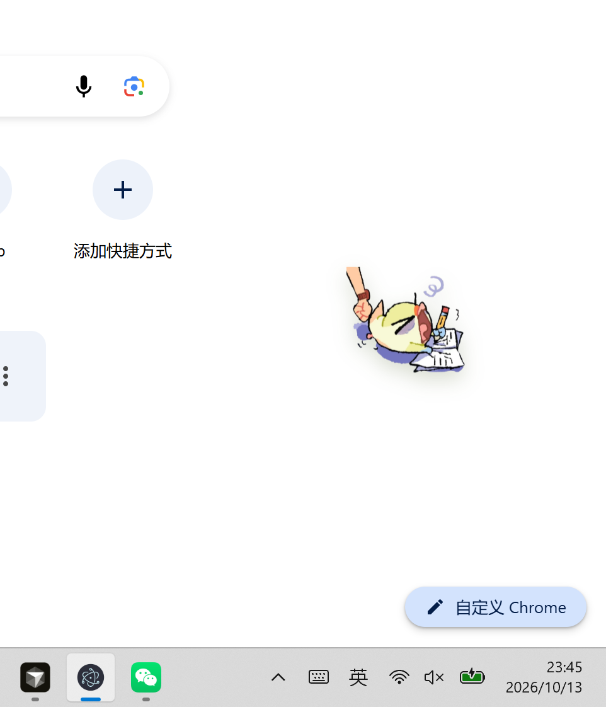
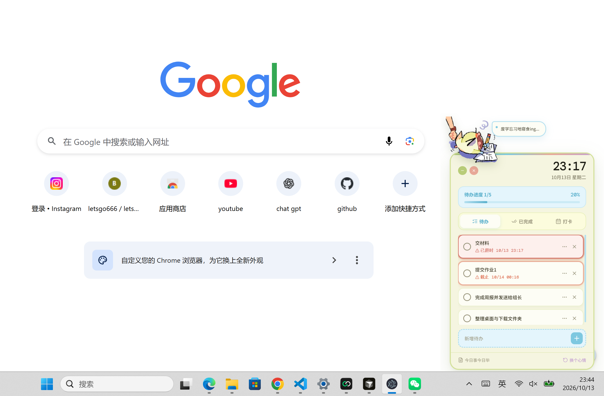

# TodoDeskPet · 待办打卡桌面宠物

一个在桌面上陪伴你的待办打卡桌宠，帮你管理待办事项、养成打卡习惯，累了还有可爱桌宠陪你。

## ✨ 功能特性

- 🐾 **桌面桌宠** —— 可拖动、可切换形象，始终置顶在桌面角落
- 📝 **待办管理** —— 添加、完成、删除待办事项，支持截止日期提醒
- ✅ **习惯打卡** —— 记录每日习惯打卡，自动统计连续天数
- 💬 **情绪语录** —— 桌宠随机弹出有趣的吐槽与鼓励
- 💾 **本地存储** —— 所有数据保存在本地，无需联网

## 🖼️ 截图





## 📥 下载安装

### 直接下载（推荐）

前往 [Releases 页面](https://github.com/X-jq/todo-deskpet/releases) 下载最新版本的 `TodoDeskPet Setup x.x.x.exe`，双击安装即可。

> 安装时若 Windows 提示「已保护你的电脑」，点击「更多信息」→「仍要运行」即可

安装完成后，桌面会出现 `TodoDeskPet` 快捷方式，双击即可启动。

### 开机自启

安装后若希望开机自动运行：

1. 按 `Win + R`，输入 `shell:startup` 回车
2. 将桌面的 `TodoDeskPet` 快捷方式复制到打开的文件夹中

## 🚀 使用说明

| 操作     | 说明                                 |
| -------- | ------------------------------------ |
| 拖动桌宠 | 按住桌宠主体可拖动到桌面任意位置     |
| 切换形象 | 点击桌宠切换不同的宠物形象           |
| 查看待办 | 点击桌宠打开/收起待办面板            |
| 添加待办 | 在输入框输入内容后回车或点击加号     |
| 完成待办 | 点击待办左侧的圆形按钮标记完成       |
| 习惯打卡 | 在「打卡」标签页点击习惯进行每日打卡 |

## 🛠️ 开发指南

### 环境要求

- Node.js >= 18
- npm >= 9

### 安装依赖

```bash
npm install
```

### 开发模式

```bash
npm run dev
```

会同时启动 Vite 开发服务器和 Electron 窗口。

### 打包为安装程序

```bash
npm run electron:build
```

打包完成后，安装包位于 `release/` 目录下。

> 打包时若遇到网络问题，可设置代理：
> ```bash
> # PowerShell
> $env:HTTPS_PROXY="http://127.0.0.1:你的代理端口"
> $env:HTTP_PROXY="http://127.0.0.1:你的代理端口"
> npm run electron:build
> ```

## 🧱 技术栈

- [Electron](https://www.electronjs.org/) —— 跨平台桌面应用框架
- [React](https://react.dev/) —— UI 框架
- [Vite](https://vitejs.dev/) —— 构建工具
- [Tailwind CSS](https://tailwindcss.com/) —— 样式框架
- [electron-store](https://github.com/sindresorhus/electron-store) —— 本地数据存储

## 📄 License

MIT